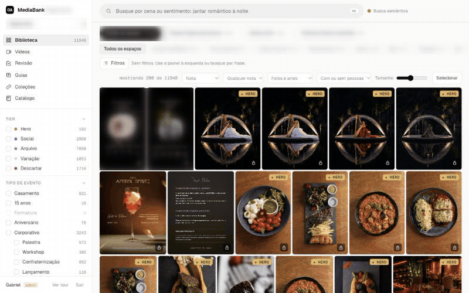

# MediaBank

Banco de fotos e vídeos com IA para quem produz conteúdo a partir do acervo de um cliente. O MediaBank lê o
Google Drive (ou uma pasta local), descreve cada foto e cada cena de vídeo dentro do vocabulário daquele cliente e
deixa tudo buscável por frase: "garçom servindo canapé em evento corporativo" acha a cena certa sem ninguém ter
etiquetado nada à mão.

## O que ele faz

- **Fotos:** baixa do Drive, reprova a que está sem foco ou mal exposta, e a IA preenche título, descrição, espaço,
  tipo de evento, luz, pessoas, marca de terceiro e notas de qualidade. Valor fora do vocabulário do cliente é recusado.
- **Vídeos:** o servidor nunca baixa vídeo. Um trabalhador no Mac corta em cenas, mede tremido e estética, tira um
  quadro por cena, e a IA descreve cada uma. Takes repetidos viram um grupo e só o melhor aparece na busca.
- **Busca por significado:** frase em português, com facetas por espaço, tipo de evento, nota e orientação.
- **Proteção:** criança, material descartado e sem autorização de imagem nunca saem para fora. Para fora só sai o
  aprovado.
- **Painel:** biblioteca, vídeos, coleções com link público, revisão de peça montada plano a plano e guias do
  cliente (brandbook e playbook de edição).
- **Para agentes e sistemas:** API HTTP (v1 para fotos aprovadas, v2 para vídeo e imagem), servidor MCP para o Claude
  e plugin do get-brolls.

Atende mais de um cliente na mesma instância. O repositório vem com dois clientes fictícios, `exemplo` (Casa Exemplo)
e `outro` (Marca Exemplo), em `src/vocabularios/`.

## Para quem usa o get-brolls

O plugin `mediabank` faz o get-brolls buscar no acervo do cliente junto com YouTube e bancos de imagem, já filtrando
o que derruba anúncio (imagem gerada por IA, texto sobreposto, logo de terceiro) e trazendo o trecho da cena em MP4
cortado do original. Ele é distribuído pela biblioteca de plugins da comunidade do get-brolls; a inclusão está em
revisão. Detalhes em [docs/COMO-FUNCIONA.md](docs/COMO-FUNCIONA.md#plugin-do-get-brolls).

## Requisitos

- Node 22 ou mais novo
- Chave do OpenRouter para a IA e o embedding
- Opcional: cliente OAuth do Google (Drive), SMTP (convites e senha), Python 3.12 com `uv` e `ffmpeg` para o
  trabalhador de vídeo (`py/`)

## Instalação rápida

1. `npm ci`
2. `cp .env.example .env` e preencha pelo menos `OPENROUTER_API_KEY`
3. Crie o primeiro usuário (a senha entra pelo stdin): `read -rs SENHA && printf %s "$SENHA" | node scripts/criar-usuario.js voce@exemplo.com "Seu Nome" --admin`
4. Traga as fotos: `node scripts/importar-pasta.js <pasta>` (ou configure o Drive com `node scripts/autorizar-drive.js`)
5. `npm start` e abra `http://localhost:3000`

Testes: `npm test`.

Como tudo funciona (pipeline, clientes, chaves, API, MCP, plugin e deploy): [docs/COMO-FUNCIONA.md](docs/COMO-FUNCIONA.md).
